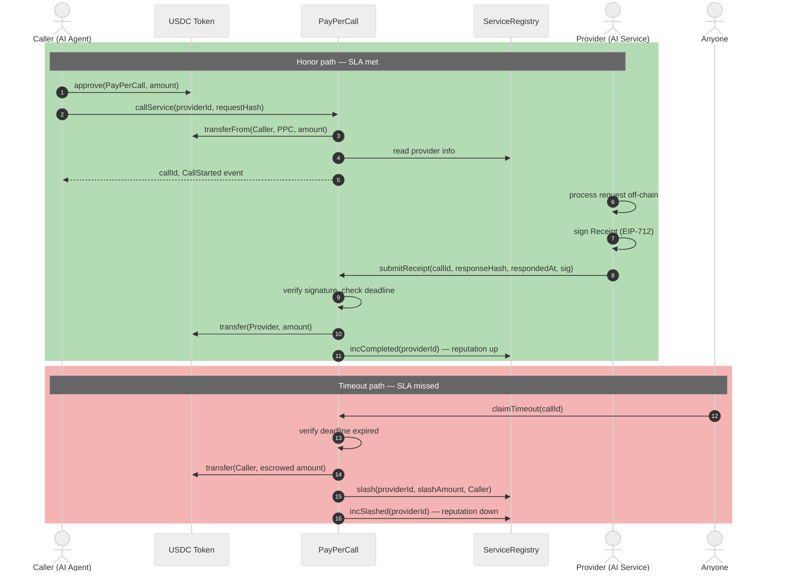

# CallGuard

> Built by an Arc Architects program member.

**Programmable service settlement for autonomous services — built on Arc.**

Providers stake USDC and commit to a response-time SLA. Callers pay per request and get a signed receipt. Miss the deadline and the stake is slashed automatically — no court, no arbiter, no middleman.

Built on [Arc Testnet](https://www.arc.network), Circle's stablecoin-native L1 where USDC is the native gas token. Every interaction — call, receipt, slash — costs a fraction of a cent and settles in under a second.

**Live demo:** [arcsla.vercel.app](https://arcsla.vercel.app)

---

## Why this matters

AI agents and autonomous services are becoming core infrastructure. As they interact with more external APIs and digital services, they need a reliable way to pay, verify execution, and hold providers accountable — without trusting a centralized intermediary.

CallGuard makes service reliability programmable:

- Provider stakes USDC as a performance bond
- Caller pays per request — USDC goes into escrow
- Provider signs an EIP-712 receipt after delivery — escrow releases
- If the provider misses the SLA window, anyone can trigger a slash — caller gets a refund plus a bonus from the stake

No governance vote. No dispute arbitration. Just contract-defined outcomes.

---

## How CallGuard compares

| | CallGuard | API3 dAPIs | Chainlink Functions | Gelato Web3 Functions | Lit Protocol |
|---|---|---|---|---|---|
| **Arbitration** | None — contract enforces | None | None | None | None |
| **Slash mechanism** | Automatic, onchain | No | No | No | No |
| **Payment model** | USDC per call, escrowed | Subscription | LINK per call | Gelato token | No payment layer |
| **Native gas token** | USDC (Arc) | ETH/various | LINK | ETH/various | Various |
| **Finality** | Sub-second (Arc) | Minutes | Minutes | Minutes | Minutes |
| **AI agent native** | Yes (MCP, x402, ERC-8004) | No | Partial | No | No |
| **Cross-chain** | Yes (CCTP, 5 chains) | Yes | No | Partial | No |
| **Reputation score** | Onchain Bayesian | No | No | No | No |
| **SLA futures market** | Yes (ERC-1155) | No | No | No | No |

CallGuard's core thesis: **financial skin-in-the-game enforces reliability better than reputation systems or legal contracts**. A provider who misses an SLA loses real money — automatically, trustlessly, instantly.

---

## Live on Arc Testnet

> **Note on Arc native USDC decimals:** Arc exposes USDC two ways. The ERC-20 `decimals()` returns **6** (standard USDC). The EVM gas layer uses **18 decimals** (wei-equivalent). MetaMask and `wallet_addEthereumChain` require `decimals: 18` — using 6 causes gas estimates to display as 10¹² × the correct value.

### Core Contracts (v5 — October 2026)

| Contract | Address | Explorer |
|---|---|---|
| `ServiceRegistry` v5 | `0xc3ff2169...` | [ArcScan ↗](https://explorer.testnet.arc.io/address/0xc3ff2169BE0E7a1f67d7D4B0a048Dbcd882e1CA9) |
| `PayPerCall` v5 | `0x389b44b7...` | [ArcScan ↗](https://explorer.testnet.arc.io/address/0x389b44b74CB8E05d5C4b8e87A2B9e30CfD41eDFE) |
| `CrossChainReceiver` v2 | `0x760326de...` | [ArcScan ↗](https://explorer.testnet.arc.io/address/0x760326dE5E50Af1CE89f3A3B8d7cE501e2bf6F8f) |
| `USDC` | `0x360000...` | [ArcScan ↗](https://explorer.testnet.arc.io/address/0x3600000000000000000000000000000000000000) |

### v2 Protocol Contracts (October 2026)

| Contract | Address | Purpose |
|---|---|---|
| `DisputeQuality` | `0x7e2771df...` | Verifiable AI output — community stake-weighted voting |
| `SLAFutures` | `0x19d03ff1...` | Provider capacity tokenized as ERC-1155 NFTs |
| `ReputationLoan` | `0x5a2f5455...` | Reputation-as-collateral USDC lending (RepFi) |
| `SLAAttestationBridge` | `0x62a63a94...` | Cross-protocol SLA oracle — onchain attestations |
| `AgentWallet` | `0xf73f2Fc5...` | ERC-4337 smart wallet with daily spend limits |
| `AgenticCommerce` | `0x0747EEf0...` | ERC-8183 Jobs — full agentic job lifecycle |
| `RegisterWithNFT` | `0x8b8aC247...` | Mint ERC-8004 NFT + register in one transaction |

---

## How it works



---

## Frontend Stack

The app at [arcsla.vercel.app](https://arcsla.vercel.app) is a full-featured React + Vite dApp with 25+ panels.

| Layer | Technology |
|-------|-----------|
| Framework | React 18 + Vite 5 + TypeScript |
| Chain | wagmi v2 + viem |
| Wallet | ConnectKit (MetaMask, Coinbase, Rainbow, injected) |
| State | Zustand (persist) |
| Subgraph | Goldsky GraphQL (`arcsla/3.0.0`) |
| Styling | Custom CSS (light/dark theme via `[data-theme]`) |
| Deploy | Vercel (SPA rewrites) |

---

## What's in the app

### Onboarding

- **Role choice modal** — on first wallet connection: choose Caller or Provider; routes to the relevant flow; persists in localStorage
- **Progress tracker** — 4-step sidebar indicator: Wallet connected → Get USDC → Make first call → Submit receipt; auto-checks completion; disappears when done
- **Contextual hints** — first-time tooltips per panel: CallBuilder, Register, Receipts, Marketplace, etc.
- **USDC balance banner** — auto-shows when connected balance < 1 USDC; faucet link
- **Simple / Pro mode** — toggle in topbar; Simple mode hides advanced panels; Pro mode exposes all 25+ features

### Before connecting a wallet

- **Live network stats** — registered providers, calls on-chain, slashes enforced (Goldsky subgraph)
- **Animated ticker bar** — scrolling strip: PROVIDERS / CALLS / HONOR RATE / SLASHES / NETWORK / CONTRACT / TIME
- **Interactive canvas** — animated particle network in hero; mouse-repel effect; green SLA flow packets
- **Scroll-reveal sections** — each landing section animates in with IntersectionObserver
- **Live activity feed** — `CallStarted`, `ReceiptSubmitted`, `CallSlashed` events
- **Provider browse** — full provider list with Bayesian honor scores; no wallet needed

### Provider tools

- **Register (v1)** — stake USDC, set price, SLA window, slash percentage
- **Register with NFT (v2)** — mint ERC-8004 AgentIdentity NFT + register in one transaction
- **Provider dashboard** — live honor rate, recent calls, stake balance, earnings analytics
- **Provider profile page** — shareable `?provider=N` URL; stats, earnings, call history
- **Revenue calculator** — estimate monthly earnings based on call volume and price
- **Deactivate + Unstake** — withdraw stake after all pending calls settle
- **Endpoint health check** — live ping per provider via facilitator proxy

### Caller tools

- **Call Builder** — EIP-3009 gasless call (no MetaMask approval needed), standard call, x402 HTTP 402 flow
- **Cost calculator** — preview USDC cost, SLA terms, slash bonus before signing
- **Caller protection** — honor rate warning below 30%; red banner + confirmation gate below 10%
- **Underfunded provider badge** — warns when stake < expected slash amount
- **SLA countdown** — live timer for open calls; Claim Timeout button activates automatically at deadline
- **Auto-router v3** — 6-factor weighted score: honor rate (35%), reputation (25%), price (15%), stake (15%), speed (10%), slash penalty
- **Batch call slider** — 1–20 calls with cost preview; one approval, sequential execution
- **Bulk call (CSV)** — send same request to multiple providers; comparison table
- **Provider comparison** — select 2–4 providers for side-by-side stats
- **Verify Receipt** — enter call ID; verify on-chain; direct link from Receipts panel (`Verify ↗` button); shareable `?verify=0x...` URL

### Payment rails

- **x402 (HTTP 402)** — EIP-3009 authorization off-chain (zero gas); facilitator calls `callServiceWithAuthorization()` onchain
- **Circle Gateway Nanopayments** — gasless 0.001 USDC micro-payments; no MetaMask prompt
- **CCTP multi-chain** — pay from Ethereum Sepolia, Base Sepolia, Polygon Amoy; CCTP V2 bridges to Arc
- **Cross-chain pill** — Arc / Base / Ethereum / Polygon selector in Call Builder

### v2 Protocol Features

- **Quality Disputes (DisputeQuality)** — response hash committed onchain; community vote; stake-weighted majority wins
- **SLA Futures (SLAFutures)** — providers tokenize capacity as ERC-1155 NFTs; callers buy priority slots
- **RepFi Lending (ReputationLoan)** — honor rate > 90%: borrow USDC against reputation; pool LPs earn APY
- **Agent Loop (AgentWallet)** — ERC-4337 wallet with daily spend limit; any AI calls services via MCP + x402 autonomously
- **SLA Bridge (SLAAttestationBridge)** — any protocol queries CallGuard: "Did provider X honor call Y?"; REST API at `/api/attestation`

### Settlement and history

- **Transaction History** — full call/receipt/slash/timeout history from Goldsky subgraph
- **Receipt verification** — verify on-chain without a wallet; `?verify=0x...` deep link from Receipts panel
- **Disputes panel** — open and resolved disputes with slash history
- **My Calls / Receipts / Payments** — per-wallet history panels
- **Claims & Jobs (ERC-8183)** — 5-step lifecycle: Create → Set Budget → Fund → Submit → Complete

### Developer tools

- **API Docs** — 9 REST endpoints with live "Try it" links, cURL / JS / Python examples
- **API / MCP panel** — 6 MCP tools for AI agents; live `list_providers` test in UI
- **Analytics** — call volume charts, honor rate trends, provider activity (canvas SVG)
- **Leaderboard** — top providers by Bayesian reputation; slash leaderboard
- **Webhooks** — configure endpoints; test with real `call.opened` payload
- **Notifications** — live `CallStarted` + `ReceiptSubmitted` contract event feed
- **Bridge** — CCTP cross-chain bridge panel
- **Admin Panel** — contract owner tools

### UX features

- **Light / Dark theme** — smooth CSS transition; default light; preference persisted
- **Command palette** — `⌘K` / `Ctrl+K`; fuzzy search across all 25 panels; keyboard navigation
- **Sidebar collapsed mode** — desktop: icon-only mode; hover reveals label
- **Mobile-first** — 320px–1440px; swipe-to-close sidebar; bottom nav bar
- **Keyboard shortcuts** — `G+O` Overview, `G+C` Call Builder, `Esc` close sidebar
- **App footer** — links: Arc Docs, Circle Developers, ArcScan, Faucet, GitHub, README, Architecture, Security, deployed contract addresses
- **Error boundary** — panels show error details + retry button instead of blank screen
- **Session budget cap** — set USDC spending limit per session

---

## REST API

Base URL: `https://arcsla.vercel.app`

| Endpoint | Method | Description |
|---|---|---|
| `/api/health` | GET | Facilitator health — RPC, signer, contract status |
| `/api/attestation?providerId=N&type=score` | GET | Provider reputation score (no wallet needed) |
| `/api/attestation?callId=0x...` | GET | Call receipt verification |
| `/api/call-service` | POST | Facilitator-mediated call (x402 flow) |
| `/api/nano-call` | POST | Gateway nanopayment call |
| `/api/nano-balance` | GET | Nanopayment balance for an address |
| `/api/auto-receipt` | POST | Provider auto-receipt webhook |
| `/api/energy-data` | GET | x402 gated endpoint (demo) |
| `/api/premium-report` | GET | x402 gated endpoint (demo) |
| `/api/widget.js` | GET | Embed script for third-party sites |

---

## Embed widget

```html
<script src="https://arcsla.vercel.app/api/widget.js"></script>
<button data-callguard-provider="1" data-callguard-payload="hello">
  Pay with CallGuard
</button>
```

---

## x402 integration

```
x402       → answers "how does the agent pay?" (HTTP 402, EIP-3009 authorization)
CallGuard  → answers "what does the agent get?" (stake-backed SLA, verifiable receipt)
```

**Flow:**

```
1. Agent  → GET /service  (no payment)
2. Server → 402 Payment Required + payment requirements
3. Agent  → signs EIP-3009 TransferWithAuthorization off-chain (no gas)
4. Facilitator → calls callServiceWithAuthorization() onchain
5. SLA clock starts — USDC in escrow
6. Provider delivers off-chain → submits EIP-712 receipt → gets paid
```

**Start a provider server:**

```bash
cd scripts
PRIVATE_KEY=0x... PROVIDER_ID=1 ARC_RPC_URL=https://rpc.testnet.arc.io node x402-provider.js
# → http://localhost:3000/service
```

---

## CCTP multi-chain payments

```
depositForBurn() on source chain
    → Circle Iris attestation (~20-60s)
    → receiveMessage() on Arc
    → CrossChainReceiver.handleReceiveFinalizedTransfer()
    → callService() fires automatically
```

**Supported source chains (testnet):** Ethereum Sepolia · Base Sepolia · Polygon Amoy

---

## Solidity example

```solidity
// 1. Caller approves USDC
usdc.approve(address(payPerCall), 1e6); // 1 USDC (6 decimals ERC-20)

// 2. Caller opens the call — USDC goes into escrow
bytes32 requestHash = keccak256(abi.encode("summarize this document"));
bytes32 callId = payPerCall.callService(providerId, requestHash);

// 3. Provider processes off-chain, signs an EIP-712 receipt
bytes32 responseHash = keccak256(responseBytes);
uint64 respondedAt = uint64(block.timestamp);
bytes memory sig = providerSigner.signTypedData(domain, types, value);

// 4. Provider submits the receipt — escrow releases, reputation increases
payPerCall.submitReceipt(callId, responseHash, respondedAt, sig);

// 5. If the provider misses the deadline — anyone can slash
payPerCall.claimTimeout(callId);
// → caller refunded + provider stake slashed + reputation decreases
```

---

## Getting started

### Prerequisites

```bash
curl -L https://foundry.paradigm.xyz | bash && foundryup
```

### Install and build

```bash
git clone https://github.com/muazzezwq/CallGuard
cd CallGuard
forge install && forge build
```

### Run tests

```bash
forge test -vv
```

Expected: **223 tests passed, 0 failed.**

### Try the demo

Open [arcsla.vercel.app](https://arcsla.vercel.app) with MetaMask — Arc Testnet is added automatically.

Get free testnet USDC from the [Arc Testnet Faucet](https://faucet.testnet.arc.io) (also covers gas).

### Deploy your own copy

```bash
cp .env.example .env
# Set USDC_ADDRESS=0x3600000000000000000000000000000000000000

cast wallet import deployer --interactive

forge script script/Deploy.s.sol:Deploy \
  --account deployer \
  --sender 0xYOUR_DEPLOYER \
  --rpc-url arc_testnet \
  --broadcast
```

See [`DEPLOY.md`](./DEPLOY.md) for the full walkthrough.

---

## Project layout

```
CallGuard/
├── contracts/                        # Solidity source (src/ in earlier versions)
│   ├── ServiceRegistry.sol           # provider registry, stake, ERC-8004 NFT, Bayesian reputation
│   ├── PayPerCall.sol                # call escrow, EIP-712 receipt verification, timeout/slash
│   ├── DisputeQuality.sol            # verifiable AI output — community stake-weighted voting
│   ├── SLAFutures.sol                # provider capacity tokenized as ERC-1155 NFTs
│   ├── ReputationLoan.sol            # reputation-as-collateral USDC lending (RepFi)
│   ├── SLAAttestationBridge.sol      # cross-protocol SLA oracle, REST API
│   ├── AgentWallet.sol               # ERC-4337 smart wallet, daily spend limit
│   ├── Subscription.sol              # recurring payment model
│   ├── Dispute.sol                   # dispute resolution with stake slashing
│   ├── CrossChainReceiver.sol        # CCTP V2 — multi-chain USDC → callService()
│   ├── RegisterWithNFT.sol           # mint ERC-8004 NFT + registerV2() in one tx
│   └── X402Middleware.sol            # HTTP 402 / EIP-3009 → callService()
├── src/                              # React + Vite + TypeScript frontend
│   ├── App.tsx                       # root — wallet gate (landing vs app shell)
│   ├── lib/config.ts                 # contract addresses, ABIs, chain config
│   ├── lib/subgraph.ts               # Goldsky GraphQL helpers
│   ├── hooks/useSubgraph.ts          # React Query wrapper with polling
│   ├── store/useAppStore.ts          # Zustand global state (theme, mode, panel)
│   └── components/
│       ├── layout/                   # AppShell, AppTopbar, Sidebar, LiveBar, Footer
│       ├── landing/                  # CgLanding (disconnected view)
│       └── panels/                   # 25 feature panels
├── test/                             # 223 Foundry tests
├── script/                           # deploy scripts
├── api/                              # Vercel serverless functions
├── subgraph/                         # Goldsky subgraph (arcsla/3.0.0)
├── x402-facilitator/                 # x402 + Gateway facilitator server
├── AGENTS.md                         # deployed contract addresses (canonical source)
├── SPEC.md
├── ARCHITECTURE.md
├── SECURITY.md
└── DEPLOY.md
```

---

## Known limitations

- **CCTP attestation takes 1–4 minutes.** Sepolia requires ~12–19 block confirmations before Circle Iris issues an attestation. The demo polls for up to 5 minutes.
- **Subgraph covers first:1000 calls.** Very old calls beyond 1000 may not appear in some panels. Goldsky subgraph covers the full history.
- **Testnet only.** All contracts are deployed on Arc Testnet. Mainnet deployment planned after independent audit.
- **`evm_version = "paris"` required.** Arc Testnet does not support the `PUSH0` opcode introduced in Shanghai/Cancun. Contracts must be compiled with `evm_version = "paris"` in `foundry.toml`.

---

## Roadmap

### Completed (Sep–Oct 2026)

**Core Protocol (v5)**
- EIP-712 typed receipt signing — structured receipt preview in MetaMask
- ERC-8004 NFT identity binding — `registerV2()` requires AgentIdentity NFT; mint + register in one tx
- CCTP multi-chain payments — Ethereum / Base / Polygon → Arc via Circle CCTP V2
- x402 HTTP payment protocol — full EIP-3009 authorization flow, gasless for the caller
- Circle Gateway Nanopayments — gasless micro-payments, server-side settlement
- ERC-8183 Jobs — full 5-step lifecycle with role badges
- 223/223 Foundry tests passing

**v2 Protocol (Oct 2026)**
- DisputeQuality — verifiable AI output, community stake-weighted arbitration
- SLAFutures — provider capacity as tradeable ERC-1155 NFTs
- ReputationLoan (RepFi) — reputation-as-collateral USDC lending
- AgentWallet — ERC-4337 autonomous agent wallet with spend limits
- SLAAttestationBridge — cross-protocol SLA oracle with REST API

**Frontend Migration (Oct 2026)**
- React 18 + Vite + TypeScript — migrated from single-file HTML/ethers.js
- wagmi v2 + viem — replaces ethers.js for all contract interactions
- ConnectKit — multi-wallet support (MetaMask, Coinbase, Rainbow, injected)
- 25 feature panels — full parity with original HTML + new panels
- Light/dark theme — smooth CSS transition, persisted in localStorage
- Canvas animations — interactive particle network, sparkline, SLA flow diagram
- Command palette `⌘K` — keyboard navigation across all panels
- Role modal — first-connection onboarding with Caller/Provider choice
- Progress tracker — 4-step sidebar completion indicator
- Contextual hints — per-panel first-time tooltips
- App footer — docs, tools, contract links
- Verify Receipt deep-link — `Verify ↗` from Receipts panel navigates without page reload
- `evm_version = "paris"` — foundry.toml updated for Arc compatibility
- `nativeCurrency.decimals = 18` — corrected for MetaMask gas display

### Planned

- APS private SLA calls — when Arc Privacy Sector precompile API is public
- EIP-1271 support for contract-wallet callers
- Reputation-weighted routing contract
- Mainnet deployment (after independent audit)

---

## Resources

### Arc & Circle

- [Arc Network](https://www.arc.network/) — project homepage
- [Arc documentation](https://docs.arc.io) — concepts, architecture, RPC, chain config
- [Circle Developers](https://developers.circle.com/) — SDKs, CCTP, Gateway, Paymaster
- [Circle Console](https://console.circle.com/signin) — API keys, testnet dashboards

### Testnet tools

- [Arc Testnet Faucet](https://faucet.testnet.arc.io) — free testnet USDC (also covers gas)
- [ArcScan Testnet](https://explorer.testnet.arc.io/) — block explorer
- [Goldsky Subgraph](https://api.goldsky.com/api/public/project_cmqryheeji1m801sy3dhe6jhk/subgraphs/arcsla/3.0.0/gn) — live GraphQL endpoint
- [thirdweb Arc Testnet](https://thirdweb.com/arc-testnet) — chain config, contract explorer

### Project documents

- [`AGENTS.md`](./AGENTS.md) — canonical deployed contract addresses
- [`ARCHITECTURE.md`](./ARCHITECTURE.md) — design decisions and rationale
- [`SECURITY.md`](./SECURITY.md) — threat model and known trade-offs
- [`DEPLOY.md`](./DEPLOY.md) — step-by-step deployment guide
- [`SPEC.md`](./SPEC.md) — original technical specification

---

MIT License. Not affiliated with Circle, Arc, or any project mentioned above. Built independently for the Arc Architects community.
