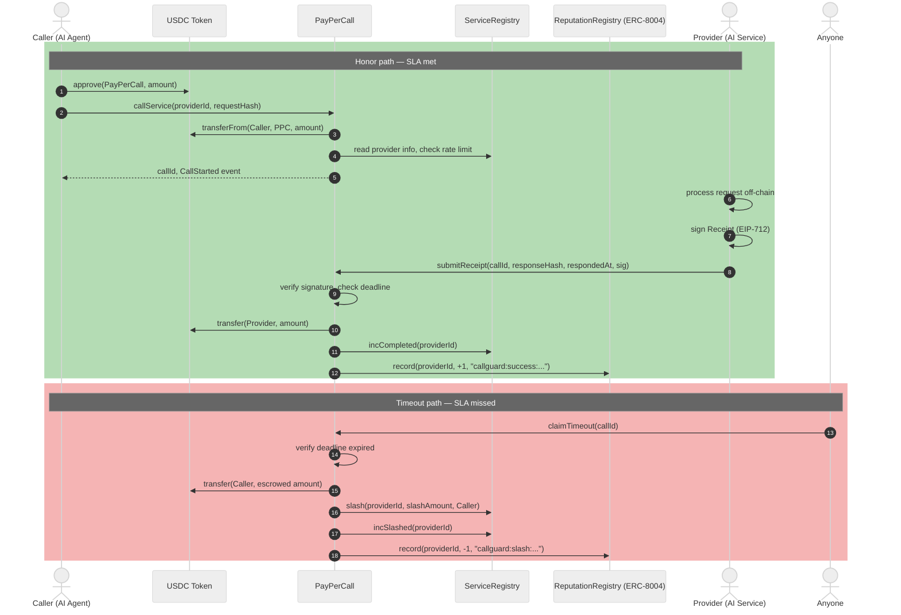

# CallGuard

> Built by an Arc Architects program member.

**Programmable service settlement for autonomous agents — built on Arc.**

Providers stake USDC and commit to a response-time SLA. Callers pay per request and get a signed receipt. Miss the deadline and the stake is slashed automatically — no ticket, no middleman. A quality dispute goes to one bonded arbiter with a single appeal, and the slash is already escrowed before the first decision.

Built on [Arc Testnet](https://www.arc.network), Circle's stablecoin-native L1 where USDC is the native gas token. Every interaction — call, receipt, slash — costs a fraction of a cent and settles in under a second.

**Live demo:** [arcsla.vercel.app](https://arcsla.vercel.app)

---

## Why this matters

AI agents and autonomous services are becoming core infrastructure. As they interact with more external APIs and digital services, they need a reliable way to pay, verify execution, and hold providers accountable — without trusting a centralized intermediary.

CallGuard makes service reliability programmable:

- Provider stakes USDC as a performance bond
- Caller pays per request — USDC goes into escrow
- Provider signs an EIP-712 receipt after delivery — escrow releases
- If the provider misses the SLA window, anyone can trigger a slash — caller gets a refund plus a bonus from the stake

No governance vote, no committee, no support queue. Timeouts settle by contract, quality disputes settle through a bonded arbiter whose silence refunds the bond automatically.

---

## How CallGuard compares

| | CallGuard | API3 dAPIs | Chainlink Functions | Gelato Web3 Functions | Lit Protocol |
|---|---|---|---|---|---|
| **Arbitration** | Contract for timeouts; one bonded arbiter + appeal for quality | None | None | None | None |
| **Slash mechanism** | Automatic, onchain | No | No | No | No |
| **Payment model** | USDC per call, escrowed | Subscription | LINK per call | Gelato token | No payment layer |
| **Native gas token** | USDC (Arc) | ETH/various | LINK | ETH/various | Various |
| **Finality** | Sub-second (Arc) | Minutes | Minutes | Minutes | Minutes |
| **AI agent native** | Yes (MCP, x402, ERC-8004) | No | Partial | No | No |
| **Cross-chain** | Yes (CCTP, 5 chains) | Yes | No | Partial | No |
| **Reputation score** | Computed in the app from on-chain counters (no ERC-8004 identity on v8) | No | No | No | No |
| **SLA futures market** | Yes (ERC-1155) | No | No | No | No |
| **Circle Refund Protocol** | Retired with `DisputeQuality`; disputes settle on `DisputeV4` | No | No | No | No |
| **Per-caller rate limiting** | Yes (DoS protection) | No | No | No | No |

CallGuard's core thesis: **financial skin-in-the-game enforces reliability better than reputation systems or legal contracts**. A provider who misses an SLA loses real money — automatically, trustlessly, instantly.

---

## Live on Arc Testnet

> **Note on Arc native USDC decimals:** Arc exposes USDC two ways. The ERC-20 `decimals()` returns **6** (standard USDC). The EVM gas layer uses **18 decimals** (wei-equivalent). MetaMask and `wallet_addEthereumChain` require `decimals: 18` — using 6 causes gas estimates to display as 10¹² × the correct value.

### Core Contracts (v8 — active, October 2026; v7 stays deployed read-only)

| Contract | Address | Role |
|---|---|---|
| `ServiceRegistryV8` | [`0x793028B6...`](https://explorer.testnet.arc.io/address/0x793028B6A1d1bdA063dC9dB5bC8930b856F512A3) | Providers, stake, terms versions, call counters |
| `PayPerCallV8` | [`0xedce61eF...`](https://explorer.testnet.arc.io/address/0xedce61eF5be31DC22cEfE342692622A26919a7EF) | Escrow, receipts, timeout claims |
| `SLAKeeper` | [`0xBe897043...`](https://explorer.testnet.arc.io/address/0xBe897043e4c21cFe9A6532e43542CA48EaD83CB7) | Permissionless batch timeout claims + bounty withdrawal |
| `DisputeV4` | [`0xECDb019F...`](https://explorer.testnet.arc.io/address/0xECDb019F1E92Ad35324cc7bBDf1D56b9e70B305B) | Active dispute path: slash escrowed at open, plus an evidence snapshot per call |
| `SLAEvidenceRegistryV2` | [`0x64872c29...`](https://explorer.testnet.arc.io/address/0x64872c29A19dF8E471103d0708397BAb96A311FC) | Anchored claims about a call: what was proven, what it assumes |
| `SLAUptime` | [`0x6916997D...`](https://explorer.testnet.arc.io/address/0x6916997DEFe98819176F66867fD5B356C284e89f) | Rolling-uptime verdict against `availabilityTargetBps` |
| `SLAProvenance` | [`0xa74D1A80...`](https://explorer.testnet.arc.io/address/0xa74D1A809184e4A906f11C9EE38fff8C1155aFeb) | Allowlisted attestor records *who* witnessed a call's payload |
| `DisputeV3` | [`0xEf9f21E...`](https://explorer.testnet.arc.io/address/0xEf9f21Ece9b4C58BCb76913887E4f4846Ec36Fec) | Superseded by `DisputeV4` on 28 Oct 2026; no slash authority, no funds held |
| `DisputeV2` | [`0xe5D993E0...`](https://explorer.testnet.arc.io/address/0xe5D993E0B328B506B874505B23b4bE876d7c0900) | Superseded by `DisputeV3`, then V4; no open disputes, no slash authority |
| `USDC` | [`0x36000000...`](https://explorer.testnet.arc.io/address/0x3600000000000000000000000000000000000000) | Native gas token, ERC-20 `decimals() = 6` |

`ServiceRegistry` v7 `0x9ca97010…7333` and `PayPerCall` v7.1 `0x5fb41dd2…0540` are still on chain but
retired — the frontend and API read only the v8 pair (`src/lib/config.ts` is the source of truth).

### Protocol Contracts (October 2026)

| Contract | Address | Purpose |
|---|---|---|
| `ReputationLoan` v3 | `0x9e062282...` | Reputation-as-collateral USDC lending (RepFi) |
| `SLAFutures` v3 | `0xcd57a9b9...` | Provider capacity tokenized as ERC-1155 NFTs |
| `Subscription` v2 | `0xc090ff2b...` | Pre-paid call bundles + StreamEscrow |
| `AgentWallet` v2 | `0x6a7a4148...` | Smart wallet with daily spend limits + ERC-8183 Pipeline Hook |
| `SLAAttestationBridge` | `0x62a63a94...` | Cross-protocol SLA oracle — onchain attestations |
| `Dispute` (legacy) | `0xa47162d8...` | Superseded by `DisputeV4` for quality disputes |
| `AgenticCommerce` | `0x0747EEf0...` | ERC-8183 Jobs — full agentic job lifecycle (third-party) |
| `RegisterWithNFT` | `0x0aBC4333...` | Mint ERC-8004 NFT + register in one transaction |

### Third-Party Protocol Addresses (Arc Testnet)

| Contract | Address | Standard |
|---|---|---|
| `IdentityRegistry` | `0x8004A818...` | ERC-8004 |
| `ReputationRegistry` | `0x8004B663...` | ERC-8004 |
| `ValidationRegistry` | `0x8004Cb1B...` | ERC-8004 |
| `AgenticCommerce` | `0x0747EEf0...` | ERC-8183 |

---

## How it works



---

## What the contracts actually enforce

Three promises, three mechanisms. Full table with per-row evidence: [`docs/SLA_COVERAGE.md`](docs/SLA_COVERAGE.md).

**A — Availability.** Each call snapshots `maxResponseTime`, `slashBps` and `availabilityTargetBps`, so terms cannot move under a live call. Past `deadline + SUBMIT_GRACE` (5 s), `PayPerCallV8.claimTimeout` is permissionless: 20 % of stake is slashed at claim time, the caller's escrow is refunded, the keeper takes `keeperBountyBps` (5 %) capped at 5 USDC. The aggregate promise — `availabilityTargetBps`, e.g. 9950 = 99.5 % — is scored by `SLAUptime` over `completedCalls / (completedCalls + slashedCalls)` since the provider's last check, gated by `minSamples` (5 on testnet, 20 intended for mainnet) and a 24 h cooldown, slashing 10 % with 20 % of it to the claimant.

**B — Quality.** A receipt is an EIP-712 signature over `(callId, responseHash, respondedAt, termsVersion)` in the `ArcSLA/2` domain, so replay, wrong signer, wrong terms version and back-dated `respondedAt` all fail. The delivered body is then checked against the committed `responseHash` locally in `Verify Receipt` (`src/lib/responseProof.ts`): a match proves the payload was not swapped after delivery, and a mismatch becomes dispute evidence an arbiter can recompute. `SLAProvenance` adds the next layer: an allowlisted attestor signs `(callId, payloadHash, originHash, observedAt)`, so the caller can see *who* witnessed the body — with the caveat that the contract verifies the witness, not the answer. Only the call's caller can open a dispute, only inside the 7-day `disputeWindow`, only on a `Completed` call, and only once.

**C — Money.** `DisputeV4` (the active dispute contract; `DisputeV3` is retired and holds no funds) slashes and **escrows at `openDispute`** — the old "serve, unstake, dodge the slash" escape is closed. Outcomes: `resolve(true)` → bond back to the caller, escrow held; `resolve(false)` → bond to the treasury; `finalize` after the 48 h appeal window pays the escrow to the winner; and if the arbiter never answers, `reclaimExpiredBond` after 7 days returns the bond to the caller and the escrow to the provider, so silence costs neither party.

### Keeper automation

Timeouts do not wait for a human. `.github/workflows/keeper.yml` asks for a 15-minute cadence (`ONCE=1`) on a GitHub-hosted runner (no server to keep alive), batches `SLAKeeper.claimBatch`, withdraws the bounty once it clears 1 USDC, and uploads its JSONL evidence as a workflow artifact. GitHub throttles scheduled workflows in quiet repositories, so the observed cadence is 3-6 h (`docs/SLA_COVERAGE.md` row A4). A late claim costs the caller time, never funds: `claimTimeout` is permissionless and the Requests panel exposes it.

Live claim (run `40221690767`, tx `0x87fc2941…2d9a`): `requested 2 / claimed 2`, gasUsed `274729`, stake `31.336784 → 20.055543 USDC`, keeper bounty `0.564061 USDC`. One of the two calls had never been touched by anyone after it opened.

### Coverage, stated honestly

29 SLA behaviours are tracked as PASS / PARTIAL / GAP: **27 PASS** (enforced, covered by a test, demonstrated on the deployed contracts), **2 PARTIAL** — `B8`, waiting on its 7-day window, and `B3b`, waiting on independence: `SLAProvenance` records an allowlisted attestor's observation of the payload, but the only attestor key is one this repository controls, and no hash proves an answer is *correct*. That last step needs attested execution (TEE or zk-proof) and CallGuard does not claim it. Per-row evidence: `docs/SLA_COVERAGE.md`.


### 7. Circle Modular Wallets (ERC-4337 + Passkey)

`src/components/PasskeyWallet.tsx` and `src/hooks/usePasskeyWallet.ts` added.
Agents can register a passkey (WebAuthn) with a username and make gasless `callService` calls via Circle Gas Station. Prerequisite: Client Key + Passkey Domain setting in Circle Console.

```bash
# add to .env
VITE_CLIENT_KEY=TEST_API_KEY:...
VITE_CLIENT_URL=https://modular-sdk.circle.com/v1/rpc/w3s/buidl
```

### 8. Gateway Unified Balance

`api/unified-balance.js` added: `GET /api/unified-balance?address=0x...` returns USDC across all chains as a single balance (no Kit Key required).
`src/components/UnifiedBalance.tsx` — shows the connected wallet's cross-chain USDC distribution.

### 9. ERC-4626 Stake Vault (Aave Arc Yield)

An `IERC4626Vault` interface was added to `ReputationLoan.sol`. Activate it with `setYieldVault(address)`; USDC deposited by LPs earns yield in the Aave Arc vault instead of sitting idle. `_ensureLiquidity()` pulls back as much as needed from the vault before borrow/withdraw.

```solidity
// After deploy:
reputationLoan.setYieldVault(AAVE_ARC_AUSDC_VAULT);
```

### 10. StreamEscrow (Subscription.sol)

`subscribeStream(providerId, lockedAmount, duration)` — locks USDC for a fixed period while the provider linearly claims the accrued amount via `claimStream(subId)`. Unlike classic per-call subscriptions, it supports a time-based SaaS model.

### 11. Chainlink Data Feeds (SLAFutures)

An `IChainlinkAggregator` interface was added to `SLAFutures.sol`. Activate the Chainlink USDC/USD feed with `setPriceFeed(address)`; `mintCapacity()` checks the batched mint value against a $1M USD cap. If no feed is set, the existing manual price is kept.

```solidity
slaFutures.setPriceFeed(CHAINLINK_USDC_USD_FEED); // Arc Testnet
```

### 12. zkML Tier System

`setZkTier(providerId, tier)` was added to `ServiceRegistry.sol` (admin only). Providers with `tier=2` get a 2x `PayPerCall` cap. Since the ERC-7992 standard is still a draft, full ZK proof verification is deferred to a future version; for now it operates as an admin-whitelist simulation.

```solidity
serviceRegistry.setZkTier(providerId, 2); // tier 2 = cap x2
```

### 13. DePIN Oracle (ServiceRegistry uptime feed)

`setUptimeOracle(address)` and `recordUptime(providerId, score, timestamp, v, r, s)` were added to `ServiceRegistry.sol`. The oracle bot writes the uptime score (0–10000 bps) with an EIP-191 signed message; `uptimeScore[providerId]` and `lastUptimePing[providerId]` are updated on-chain.

### 14. EIP-5564 Stealth Addresses

`callServiceStealth(providerId, requestHash, stealthAddress, ephemeralPubKey, metadata)` was added to `PayPerCall.sol`. It hides the caller's identity behind a one-time stealth address, optionally delegating to the `stealthAnnouncer` contract so the recipient can scan for it.

```solidity
payPerCall.setStealthAnnouncer(EIP5564_ANNOUNCER_ADDR);
```

### Post-v4.2 deploy setup

```bash
# set zkML tier
cast send $SERVICE_REGISTRY "setZkTier(uint256,uint8)" $PROVIDER_ID 2

# activate Aave Arc yield
cast send $REPUTATION_LOAN "setYieldVault(address)" $AAVE_ARC_AUSDC_VAULT

# set DePIN oracle
cast send $SERVICE_REGISTRY "setUptimeOracle(address)" $ORACLE_BOT_ADDRESS

# set Chainlink feed (Arc Testnet feed address must be obtained from Chainlink)
cast send $SLA_FUTURES "setPriceFeed(address)" $CHAINLINK_USDC_USD

# set EIP-5564 announcer
cast send $PAY_PER_CALL "setStealthAnnouncer(address)" $EIP5564_ANNOUNCER
```

---

## v4.1 — What's new (October 2026)

### Per-caller rate limiting (DoS protection)

`ServiceRegistry` providers can now set `maxConcurrentCalls` (1–65535; default 10). `PayPerCall` enforces this per `(providerId, caller)` pair — a flooded caller cannot exhaust a provider's capacity.

```solidity
// ServiceRegistry — provider sets their cap
registry.updateMaxConcurrentCalls(providerId, 5); // max 5 open calls per caller

// PayPerCall — enforced automatically, reverts with TooManyConcurrentCalls
error TooManyConcurrentCalls();
mapping(uint256 => mapping(address => uint32)) public openCallsPerCaller;
```

### Circle Agent Marketplace — x402 Bazaar discovery

`GET /api/marketplace` returns a full x402 Bazaar discovery document — `accepts` array, `inputSchema`, `outputSchema`, SLA metadata, and contract references. Any x402-aware agent can discover and pay for CallGuard services without reading documentation.

```bash
curl https://arcsla.vercel.app/api/marketplace
# → { "x402Version": 1, "services": [...], "contracts": {...} }

curl https://arcsla.vercel.app/api/marketplace/health
# → { "providers": [{ "id": 1, "status": "ok", "latencyMs": 42 }] }
```

### Gateway Nanopayments — dual-rail architecture

`POST /api/nano-call` now supports two payment rails:

| Rail | Trigger | Settlement |
|---|---|---|
| Circle Gateway batching | `GATEWAY_BATCH_URL` env set | Sub-second, off-chain batched |
| ERC-20 direct transfer | fallback (always available) | On-chain, ~0.5s on Arc |

### Circle Refund Protocol (retired)

`DisputeQuality` is no longer routed and holds no slash authority; disputes settle on `DisputeV4`. The relay described below is kept as history.

When a dispute resolved `CallerWins` on `DisputeQuality`,, `DisputeQuality` emits `CircleRefundInitiated(disputeId, callId, caller, amount)`. An off-chain relayer (or `api/auto-receipt` with `event="circle.refund.initiate"`) calls the Circle Refund API to initiate a programmatic refund for the original payment amount.

```solidity
event CircleRefundInitiated(
    uint256 indexed disputeId,
    bytes32 indexed callId,
    address indexed caller,
    uint256 amount   // original USDC payment amount (6-decimal)
);
```

### ERC-8004 ReputationRegistry — onchain reputation writes

`PayPerCall` now writes reputation events directly to the Arc Testnet `ReputationRegistry` (`0x8004B663...`):

- `submitReceipt` success: `record(providerId, +1, "callguard:success:<callId>")`
- `claimTimeout` slash: `record(providerId, -1, "callguard:slash:<callId>")`

Both calls are **best-effort** — a failing registry never reverts the main transaction. Enable via:

```solidity
payPerCall.setReputationRegistry(0x8004B663056A597Dffe9eCcC1965A193B7388713);
```

### ERC-8183 Pipeline Hook (AgentWallet)

`AgentWallet` calls `IAgenticCommerce.onCallCompleted()` after every successful `agentCall()`. The hook notifies the Arc Testnet AgenticCommerce pipeline (`0x0747EEf0...`) that the agent completed a job step — enabling multi-step job tracking and automated next-step triggering.

```solidity
agentWallet.setAgenticCommerce(0x0747EEf0706327138c69792bF28Cd525089e4583);
// → every agentCall() now fires onCallCompleted() on the pipeline
```

---

## Frontend Stack

The app at [arcsla.vercel.app](https://arcsla.vercel.app) is a full-featured React + Vite dApp with 25+ panels.

| Layer | Technology |
|-------|-----------|
| Framework | React 18 + Vite 5 + TypeScript |
| Chain | wagmi v2 + viem |
| Wallet | ConnectKit (MetaMask, Coinbase, Rainbow, injected) |
| State | Zustand (persist) |
| Subgraph | The Graph Studio (`onur/1.0.0`); v7 Goldsky is legacy |
| Styling | Custom CSS (light/dark theme via `[data-theme]`) |
| Deploy | Vercel (SPA rewrites) |

---

## What's in the app

### Onboarding

- **Role choice modal** — on first wallet connection: choose Caller or Provider; routes to the relevant flow; persists in localStorage
- **Progress tracker** — 4-step sidebar indicator: Wallet connected → Get USDC → Make first call → Submit receipt; auto-checks completion; disappears when done
- **Contextual hints** — first-time tooltips per panel: CallBuilder, Register, Receipts, Marketplace, etc.
- **USDC balance banner** — auto-shows when connected balance < 1 USDC; faucet link
- **Simple / Pro mode** — toggle in topbar; Simple mode hides advanced panels; Pro mode exposes all 25+ features

### Before connecting a wallet

- **Live network stats** — registered providers, calls on-chain, slashes enforced (v8 Studio subgraph)
- **Animated ticker bar** — scrolling strip: PROVIDERS / CALLS / HONOR RATE / SLASHES / NETWORK / CONTRACT / TIME
- **Interactive canvas** — animated particle network in hero; mouse-repel effect; green SLA flow packets
- **Scroll-reveal sections** — each landing section animates in with IntersectionObserver
- **Live activity feed** — `CallStarted`, `ReceiptSubmitted`, `CallSlashed` events
- **Provider browse** — full provider list with honor scores; no wallet needed

### Provider tools

- **Register (v1)** — stake USDC, set price, SLA window, slash percentage, concurrent call cap
- **Provider dashboard** — live honor rate, recent calls, stake balance, earnings analytics
- **Provider profile page** — shareable `?provider=N` URL; stats, earnings, call history
- **Revenue calculator** — estimate monthly earnings based on call volume and price
- **Deactivate + Unstake** — withdraw stake after all pending calls settle
- **Endpoint health check** — live ping per provider via facilitator proxy

### Caller tools

- **Call Builder** — EIP-3009 gasless call (no MetaMask approval needed), standard call, x402 HTTP 402 flow
- **Cost calculator** — preview USDC cost, SLA terms, slash bonus before signing
- **Caller protection** — honor rate warning below 30%; red banner + confirmation gate below 10%
- **Underfunded provider badge** — warns when stake < expected slash amount
- **SLA countdown** — live timer for open calls; Claim Timeout button activates automatically at deadline
- **Auto-router v3** — 6-factor weighted score: honor rate (35%), reputation (25%), price (15%), stake (15%), speed (10%), slash penalty
- **Batch call slider** — 1–20 calls with cost preview; one approval, sequential execution
- **Bulk call (CSV)** — send same request to multiple providers; comparison table
- **Provider comparison** — select 2–4 providers for side-by-side stats
- **Verify Receipt** — enter call ID; verify on-chain; direct link from Receipts panel (`Verify ↗` button); shareable `?verify=0x...` URL

### Payment rails

- **x402 (HTTP 402)** — EIP-3009 authorization off-chain (zero gas); facilitator calls `callServiceWithAuthorization()` onchain
- **Circle Gateway Nanopayments** — dual-rail: Gateway batching (< 500ms) or ERC-20 direct fallback
- **CCTP multi-chain** — pay from Ethereum Sepolia, Base Sepolia, Polygon Amoy; CCTP V2 bridges to Arc
- **Cross-chain pill** — Arc / Base / Ethereum / Polygon selector in Call Builder

### v2 Protocol Features

- **Quality Disputes (`DisputeV4`)** — slash escrowed at `openDispute` so the provider cannot unstake out of it; 2 USDC caller bond, arbiter decision, one 3 USDC appeal, `finalize` after the 48 h window, `reclaimExpiredBond` if the arbiter stays silent. `openDispute` also snapshots every configured evidence kind for that call (`SLAEvidenceRegistryV2`): a proof can be shown, it can never move money
- **SLA Futures (SLAFutures)** — providers tokenize capacity as ERC-1155 NFTs; callers buy priority slots
- **RepFi Lending (ReputationLoan)** — honor rate > 90%: borrow USDC against reputation; pool LPs earn APY
- **Agent Loop (AgentWallet)** — smart wallet with daily spend limit; ERC-8183 pipeline hook; any AI calls services via MCP + x402 autonomously
- **SLA Bridge (SLAAttestationBridge)** — any protocol queries CallGuard: "Did provider X honor call Y?"; REST API at `/api/attestation`

### Settlement and history

- **Transaction History** — full call/receipt/slash/timeout history from the v8 Studio subgraph
- **Receipt verification** — verify on-chain without a wallet; `?verify=0x...` deep link from Receipts panel; the panel also hashes a pasted payload and compares it with the committed `responseHash`, with one click to hand a mismatch to the dispute form
- **Disputes panel** (`DisputesV8`) — live `DisputeV4` state: bond, appeal bond, slash preview, disputeable calls with their remaining window, what each escrow does next, and the evidence rows captured at open
- **Availability panel** (`Uptime`) — published target vs observed rate, sample count, cooldown countdown, slash/bounty preview before an `SLAUptime` claim
- **My Calls / Receipts / Payments** — per-wallet history panels
- **Claims & Jobs (ERC-8183)** — 5-step lifecycle: Create → Set Budget → Fund → Submit → Complete

### Developer tools

- **API Docs** — 11 REST endpoints with live "Try it" links, cURL / JS / Python examples
- **API / MCP panel** — 6 MCP tools for AI agents; live `list_providers` test in UI
- **Analytics** — call volume charts, honor rate trends, provider activity (canvas SVG)
- **Leaderboard** — top providers by reputation; slash leaderboard
- **Webhooks** — configure endpoints; test with real `call.opened` payload
- **Notifications** — live `CallStarted` + `ReceiptSubmitted` contract event feed
- **Bridge** — CCTP cross-chain bridge panel
- **Admin Panel** — read-only wiring card (the three write forms were removed)

### UX features

- **Light / Dark theme** — smooth CSS transition; default light; preference persisted
- **Command palette** — `⌘K` / `Ctrl+K`; fuzzy search across all 25+ panels; keyboard navigation
- **Sidebar collapsed mode** — desktop: icon-only mode; hover reveals label
- **Mobile-first** — 320px–1440px; swipe-to-close sidebar; bottom nav bar
- **Keyboard shortcuts** — `G+O` Overview, `G+C` Call Builder, `Esc` close sidebar
- **App footer** — links: Arc Docs, Circle Developers, ArcScan, Faucet, GitHub, README, Architecture, Security, deployed contract addresses
- **Error boundary** — panels show error details + retry button instead of blank screen
- **Session budget cap** — set USDC spending limit per session

---

## REST API

Base URL: `https://arcsla.vercel.app`

| Endpoint | Method | Description |
|---|---|---|
| `/api/health` | GET | Facilitator health — RPC, signer, contract status |
| `/api/attestation?providerId=N&type=score` | GET | Provider reputation score (no wallet needed) |
| `/api/attestation?callId=0x...` | GET | Call receipt verification |
| `/api/call-service` | POST | Facilitator-mediated call (x402 flow, full `accepts` array) |
| `/api/nano-call` | POST | Gateway nanopayment call (dual-rail: Gateway + ERC-20 fallback) |
| `/api/nano-balance` | GET | Nanopayment balance for an address |
| `/api/auto-receipt` | POST | Provider auto-receipt webhook + Circle Refund Protocol relay |
| `/api/marketplace` | GET | x402 Bazaar discovery — service listing, schemas, SLA metadata |
| `/api/marketplace/health` | GET | Live provider endpoint health check |
| `/api/energy-data` | GET | x402 gated endpoint (demo) |
| `/api/premium-report` | GET | x402 gated endpoint (demo) |

---

## Embed widget

```html
<script src="https://arcsla.vercel.app/api/widget.js"></script>
<button data-callguard-provider="1" data-callguard-payload="hello">
  Pay with CallGuard
</button>
```

---

## x402 integration

```
x402       → answers "how does the agent pay?" (HTTP 402, EIP-3009 authorization)
CallGuard  → answers "what does the agent get?" (stake-backed SLA, verifiable receipt)
```

**Flow:**

```
1. Agent  → GET /service  (no payment)
2. Server → 402 Payment Required + accepts array (x402Version: 1)
3. Agent  → signs EIP-3009 TransferWithAuthorization off-chain (no gas)
4. Facilitator → calls callServiceWithAuthorization() onchain
5. SLA clock starts — USDC in escrow
6. Provider delivers off-chain → submits EIP-712 receipt → gets paid
7. ReputationRegistry records +1 score onchain (ERC-8004)
```

**Circle Agent Marketplace discovery:**

```bash
# Discover all CallGuard services (x402 Bazaar format)
curl https://arcsla.vercel.app/api/marketplace

# Check live provider health
curl https://arcsla.vercel.app/api/marketplace/health
```

**Start a provider server:**

```bash
cd scripts
PRIVATE_KEY=0x... PROVIDER_ID=1 ARC_RPC_URL=https://rpc.testnet.arc.io node x402-provider.js
# → http://localhost:3000/service
```

---

## CCTP multi-chain payments

```
depositForBurn() on source chain
    → Circle Iris attestation (~20-60s)
    → receiveMessage() on Arc
    → CrossChainReceiver.handleReceiveFinalizedTransfer()
    → callService() fires automatically
```

**Supported source chains (testnet):** Ethereum Sepolia · Base Sepolia · Polygon Amoy

---

## Solidity example

```solidity
// 1. Caller approves USDC
usdc.approve(address(payPerCall), 1e6); // 1 USDC (6 decimals ERC-20)

// 2. Caller opens the call — USDC goes into escrow
bytes32 requestHash = keccak256(abi.encode("summarize this document"));
bytes32 callId = payPerCall.callService(providerId, requestHash);

// 3. Provider processes off-chain, signs an EIP-712 receipt
bytes32 responseHash = keccak256(responseBytes);
uint64 respondedAt = uint64(block.timestamp);
bytes memory sig = providerSigner.signTypedData(domain, types, value);

// 4. Provider submits the receipt — escrow releases, +1 reputation recorded
payPerCall.submitReceipt(callId, responseHash, respondedAt, sig);

// 5. If the provider misses the deadline — anyone can slash, -1 reputation recorded
payPerCall.claimTimeout(callId);
// → caller refunded + provider stake slashed + ERC-8004 reputation decreases
```

---

## Getting started

### Prerequisites

```bash
curl -L https://foundry.paradigm.xyz | bash && foundryup
```

### Install and build

```bash
git clone https://github.com/muazzezwq/CallGuard
cd CallGuard
forge install && forge build
```

### Run tests

```bash
forge test -vv
```

Expected: all tests passing, 0 failed, across 30 suites (`forge test`; 621 passing when last measured on 31 Oct 2026).

### Try the demo

Open [arcsla.vercel.app](https://arcsla.vercel.app) with MetaMask — Arc Testnet is added automatically.

Get free testnet USDC from the Arc Studio sidebar ("Get test USDC") or the [Arc Testnet Faucet](https://faucet.testnet.arc.io).

### Deploy your own copy

```bash
cp .env.example .env
# Set USDC_ADDRESS=0x3600000000000000000000000000000000000000

cast wallet import deployer --interactive

forge script script/DeployV8.s.sol:DeployV8 \
  --account deployer \
  --sender 0xYOUR_DEPLOYER \
  --rpc-url arc_testnet \
  --broadcast
```

That deploys the v8 pair plus `SLAKeeper`. The evidence layer (`SLAEvidenceRegistryV2`,
`DisputeV4`) has its own script, `script/DeployEvidenceV2.s.sol`. `script/Deploy.s.sol` is the
retired v7 pair: its contracts are still deployed and read-only.

See [`DEPLOY.md`](./DEPLOY.md) for the full walkthrough.

### Enable v4.1 features after deploy

```bash
# Enable ERC-8004 ReputationRegistry writes
cast send $PAY_PER_CALL "setReputationRegistry(address)" \
  0x8004B663056A597Dffe9eCcC1965A193B7388713 \
  --account deployer --rpc-url arc_testnet

# Enable ERC-8183 Pipeline Hook on AgentWallet
cast send $AGENT_WALLET "setAgenticCommerce(address)" \
  0x0747EEf0706327138c69792bF28Cd525089e4583 \
  --account deployer --rpc-url arc_testnet

# Set per-caller rate limit for a provider
cast send $SERVICE_REGISTRY "updateMaxConcurrentCalls(uint256,uint32)" \
  1 5 --account deployer --rpc-url arc_testnet
```

---

## Project layout

```
CallGuard/
├── contracts/                        # Solidity source (v7 files are legacy but still deployed)
│   ├── ServiceRegistry.sol           # v7 registry — read-only since the v8 cutover
│   ├── PayPerCall.sol                # v7 escrow + EIP-712 receipt — read-only, kept for V7Cleanup
│   ├── DisputeQuality.sol            # retired: Circle Refund Protocol era disputes
│   ├── SLAFutures.sol                # provider capacity tokenized as ERC-1155 NFTs (v7)
│   ├── ReputationLoan.sol            # reputation-as-collateral USDC lending (RepFi, v7)
│   ├── SLAAttestationBridge.sol      # cross-protocol SLA oracle, REST API (v7)
│   ├── AgentWallet.sol               # smart wallet with daily spend limits + ERC-8183 hook (v7)
│   ├── Subscription.sol              # recurring payment model (v7)
│   ├── Dispute.sol                   # dispute resolution with stake slashing
│   ├── CrossChainReceiver.sol        # CCTP V2 — multi-chain USDC → callService()
│   ├── RegisterWithNFT.sol           # mint ERC-8004 NFT + registerV2() in one tx
│   ├── X402Middleware.sol            # HTTP 402 / EIP-3009 → callService()
│   └── interfaces/
│       ├── IServiceRegistry.sol      # IServiceRegistry + IERC8004ReputationRegistry
│       └── IPayPerCall.sol
├── src/                              # React + Vite + TypeScript frontend
│   ├── App.tsx                       # root — wallet gate (landing vs app shell)
│   └── components/
│       ├── Architecture.tsx          # architecture diagram panel
│       └── CgLanding.tsx             # landing page (disconnected view)
├── test/                             # 621 Foundry tests, 30 suites
├── script/                           # deploy scripts
├── api/                              # Vercel serverless functions
│   ├── marketplace.js                # x402 Bazaar discovery endpoint (NEW)
│   ├── call-service.js               # x402 facilitator (full accepts array)
│   ├── nano-call.js                  # Gateway nanopayments (dual-rail)
│   └── auto-receipt.js               # auto-receipt + Circle Refund Protocol relay
├── subgraph/                         # v8 Studio indexer (onur/1.0.0); v7 Goldsky legacy
├── x402-facilitator/                 # x402 + Gateway facilitator server
├── AGENTS.md                         # deployed contract addresses (canonical source)
├── SPEC.md
├── ARCHITECTURE.md
├── SECURITY.md
└── DEPLOY.md
```

---

## Known limitations

- **CCTP attestation takes 1–4 minutes.** Sepolia requires ~12–19 block confirmations before Circle Iris issues an attestation. The demo polls for up to 5 minutes.
- **Subgraph panels query up to 1000 rows.** The v8 Studio subgraph covers the full indexed history; some panels cap their query at `first:1000`.
- **Testnet only.** All contracts are deployed on Arc Testnet. Mainnet deployment planned after independent audit.
- **ERC-8004 ReputationRegistry is best-effort.** If the registry reverts (e.g. permissions not granted), the main `submitReceipt` / `claimTimeout` still succeeds. Check `ReputationRecorded(success=false)` events.
- **ERC-8183 hook is best-effort.** If `onCallCompleted()` reverts, `agentCall()` still succeeds. Check `PipelineHookCalled(success=false)` events.

---

## Roadmap

### Completed (Sep–Oct 2026)

**SLA enforcement (v8, Oct 2026)**
- `ServiceRegistryV8` + `PayPerCallV8` — per-call terms snapshot, `bytes32` call ids, EIP-712 `ArcSLA/2` receipts with `respondedAt` and the call's `termsVersion`
- `DisputeV3` — slashes and escrows at `openDispute`, so unstaking between receipt and verdict no longer dodges a quality slash; `finalize` and `reclaimExpiredBond` settle arbiter silence
- `SLAUptime` — the published `availabilityTargetBps` is scored against rolling uptime and actually slashed (first live claim: 99.5 % target vs 57.14 % delivered, 5.373248 USDC)
- `SLAProvenance` — an allowlisted attestor signs `(callId, payloadHash, originHash, observedAt)`; the contract recovers the signer, so a caller can check *who* witnessed the payload (live record for call `0x8cfa1821…`)
- Keeper automation — `.github/workflows/keeper.yml` asks for a 15-minute cadence (`ONCE=1`) on a GitHub runner; observed cadence 3-6 h, batches `claimBatch`, withdraws bounties, uploads JSONL evidence
- Per-caller concurrency caps tested on v8 (`maxConcurrentCalls`, default 10)
- Foundry suite green: 621 passing across 30 suites when last measured on 30 Oct 2026; coverage table in `docs/SLA_COVERAGE.md`

**Core Protocol (v5) — historical; items retired on v8 are marked**
- EIP-712 typed receipt signing — structured receipt preview in MetaMask
- ERC-8004 NFT identity binding — `registerV2()` requires AgentIdentity NFT; mint + register in one tx *(retired on v8: `ServiceRegistryV8.register()` mints nothing and carries no NFT binding)*
- CCTP multi-chain payments — Ethereum / Base / Polygon → Arc via Circle CCTP V2
- x402 HTTP payment protocol — full EIP-3009 authorization flow, gasless for the caller
- Circle Gateway Nanopayments — gasless micro-payments, server-side settlement
- ERC-8183 Jobs — full 5-step lifecycle with role badges
- 223/223 Foundry tests passing (at the time; the suite is 621 today)

**v2 Protocol (Oct 2026) — historical; retired on v8 unless noted**
- DisputeQuality — community stake-weighted arbitration *(retired; v8 disputes settle on `DisputeV4`)*
- SLAFutures — provider capacity as tradeable ERC-1155 NFTs
- ReputationLoan (RepFi) — reputation-as-collateral USDC lending
- AgentWallet — smart wallet with daily spend limits
- SLAAttestationBridge — cross-protocol SLA oracle with REST API

**v4.1 (Oct 2026)**
- Per-caller rate limiting — `maxConcurrentCalls` per provider, DoS protection, `TooManyConcurrentCalls` error
- Circle Agent Marketplace — x402 Bazaar discovery endpoint (`/api/marketplace`)
- Gateway Nanopayments dual-rail — Circle Gateway batching + ERC-20 direct fallback
- Circle Refund Protocol — `CircleRefundInitiated` event on `CallerWins` dispute *(retired with `DisputeQuality`; the `api/auto-receipt` relay still runs)*
- ERC-8004 ReputationRegistry writes — `+1` on receipt, `-1` on slash, best-effort
- ERC-8183 Pipeline Hook — `AgentWallet.setAgenticCommerce()` fires `onCallCompleted()` after every call *(v7-era `AgentWallet`; the v8 call path has no pipeline hook)*
- 621/621 Foundry tests passing (30 suites), measured 31 Oct 2026

**Frontend Migration (Oct 2026)**
- React 18 + Vite + TypeScript — migrated from single-file HTML/ethers.js
- wagmi v2 + viem — replaces ethers.js for all contract interactions
- ConnectKit — multi-wallet support
- 25+ feature panels — full parity with original HTML + new panels
- Light/dark theme, command palette `⌘K`, role modal, progress tracker

### Planned

- Circle Modular Wallets — passkey (WebAuthn) + Circle Gas Station paymaster
- Gateway Unified Balance — < 500ms cross-chain USDC pooling
- ERC-4626 Stake Vault — Aave Arc integration for staked USDC yield
- StreamEscrow SLA — Subscription.sol stream-based payments
- Chainlink Data Feeds + CCIP — price feeds for SLAFutures, cross-chain reputation
- APS private SLA calls — when Arc Privacy Sector precompile API is public
- EIP-1271 support — contract-wallet callers
- Mainnet deployment — after independent audit

---

## Resources

### Arc & Circle

- [Arc Network](https://www.arc.network/) — project homepage
- [Arc documentation](https://docs.arc.io) — concepts, architecture, RPC, chain config
- [Circle Developers](https://developers.circle.com/) — SDKs, CCTP, Gateway, Paymaster
- [Circle Console](https://console.circle.com/signin) — API keys, testnet dashboards

### Testnet tools

- [Arc Testnet Faucet](https://faucet.testnet.arc.io) — free testnet USDC (also covers gas)
- [ArcScan Testnet](https://explorer.testnet.arc.io/) — block explorer
- [v8 Subgraph](https://api.studio.thegraph.com/query/1763627/onur/1.0.0) — live GraphQL endpoint (The Graph Studio)
- [Goldsky Subgraph (v7 legacy)](https://api.goldsky.com/api/public/project_cmqryheeji1m801sy3dhe6jhk/subgraphs/callguard-v7/1.1.0/gn) — read-only legacy endpoint
- [thirdweb Arc Testnet](https://thirdweb.com/arc-testnet) — chain config, contract explorer

### Project documents

- [`AGENTS.md`](./AGENTS.md) — canonical deployed contract addresses
- [`docs/SLA_COVERAGE.md`](./docs/SLA_COVERAGE.md) — what is enforced per SLA behaviour, with proof and open gaps
- [`docs/V8_DEPLOYMENT.md`](./docs/V8_DEPLOYMENT.md) — v8 deploy record, DisputeV3 and SLAUptime runbooks
- [`ARCHITECTURE.md`](./ARCHITECTURE.md) — design decisions and rationale
- [`SECURITY.md`](./SECURITY.md) — threat model and known trade-offs
- [`DEPLOY.md`](./DEPLOY.md) — step-by-step deployment guide
- [`SPEC.md`](./SPEC.md) — original technical specification

---

MIT License. Not affiliated with Circle, Arc, or any project mentioned above. Built independently for the Arc Architects community.
